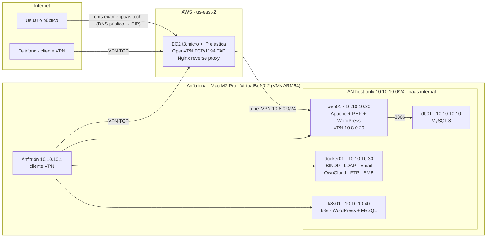

# Examen en casa — PaaS (II-2026)

Red de servicios segura, virtualizada en una sola máquina física:

- **Servicios nativos** (sin contenedores): MySQL en `db01` y Apache + PHP + WordPress en `web01`, con HTTP y HTTPS firmado por una **CA propia (OpenSSL)**.
- **6 servicios con Docker Compose** en `docker01`.
- **WordPress en Kubernetes** (k3s) en `k8s01`.
- **VPN OpenVPN (TCP/TAP) en AWS**, desplegada con **Terraform + Ansible**.
- **Acceso público al CMS** con nombre de dominio: `cms.examenpaas.tech` → EC2 (Nginx) → túnel VPN → `web01`.

> **Estado actual: Fase 0 (preparación).** Empezar por [`docs/fase-0.md`](docs/fase-0.md).

## Equipo

| Rol | Nombre | Usuario GitHub | Rubros a cargo | Peso a cargo |
|---|---|---|---|---|
| **Estudiante A** | Angie Esquivel | [@An-Gi](https://github.com/An-Gi) | VPN con IaC · Acceso público (DNS) · Docker: DNS, LDAP, Email · Extra: Schleuder · DNS público (BIND en EC2) · Docs §2–§3 | 50 % |
| **Estudiante B** | Alejandro Quesada | [@AleQuesada2012](https://github.com/AleQuesada2012) | DB + Web + CMS nativo (con CA) · CMS en Kubernetes · Docker: OwnCloud, FileServer (FTP, SMB, NFS) · Extra: DHCP · Docs §5–§6 + PDF | 50 % |

Roles y dominio acordados en el kick-off del 2026-11-25. Dominio público: **`examenpaas.tech`** (name.com, GitHub Student Developer Pack).
Detalle, backlog y horas estimadas: [`docs/division-trabajo.md`](docs/division-trabajo.md).
**Ambos deben poder explicar todo** (la defensa lo exige): ver el protocolo de transferencia en ese mismo documento.

## Arquitectura



Fuente editable del diagrama: [`docs/diagramas/red.mmd`](docs/diagramas/red.mmd). Decisiones: [`docs/decisiones/`](docs/decisiones/).

## Estructura del repositorio

```
.
├── ca/              B · Entidad certificadora OpenSSL ............ Fase 1 (20 %)
├── nativo/          B · db01 (MySQL) y web01 (Apache+WordPress) .. Fase 1 (20 %)
├── terraform/       A · EC2, SG, IP elástica, inventario ......... Fase 2 (20 %)
├── ansible/         A · Roles openvpn y nginx_proxy .............. Fases 2 y 5
├── docker/          A+B · 6 servicios Docker Compose ............. Fase 3 (30 %)
│   ├── 01-dns-bind9   A        04-owncloud  B
│   ├── 02-ldap        A        05-ftp       B
│   ├── 03-email       A        06-smb       B
│   ├── 07-dhcp        B (extra)  08-schleuder A (extra) ........ Fase 6 (+10 %, ADR-0003)
│   └── extras/        uptime-kuma: panel de apoyo, no se cuenta
├── k8s/             B · WordPress en k3s ......................... Fase 4 (10 %)
├── dns-publico/     A · Registro público y verificación .......... Fase 5 (10 %)
├── scripts/         Utilidades: entorno, VMs, bitácora, commits
├── docs/            Documentación (9 secciones), bitácoras, ADRs, guion de defensa
└── .github/         Plantillas de PR / issues y CODEOWNERS
```

Cada carpeta tiene un `README.md` con: responsable, criterios de "terminado", **prueba de demo** y preguntas probables en la defensa.

## Estado por rubro

| Rubro | Peso | Responsable | Carpeta | Estado |
|---|---|---|---|---|
| 6 servicios con Docker Compose | 30 % | A (3) + B (3) | `docker/` | 🟨 (B: 3/3 ✅) |
| DB + WebServer + CMS sin contenedores | 20 % | B | `nativo/`, `ca/` | ✅ |
| VPN con IaC (Terraform + Ansible) | 20 % | A | `terraform/`, `ansible/` | ⬜ |
| CMS con Kubernetes | 10 % | B | `k8s/` | ⬜ |
| Acceso público al CMS con dominio | 10 % | A | `dns-publico/`, `ansible/roles/nginx_proxy` | ⬜ |
| Documentación | 10 % | A + B | `docs/` | ⬜ |
| Extra (máx. 2 servicios, del enunciado) | +10 % | A (Schleuder) + B (DHCP) | `docker/07-dhcp`, `docker/08-schleuder` | ⬜ |

Leyenda: ⬜ pendiente · 🟨 en progreso · ✅ demostrable · 🔒 snapshot tomado

## Comandos útiles

```bash
make ayuda            # lista de objetivos
make verificar ROL=a  # herramientas del Estudiante A (ROL=b para B)
make horas            # suma de horas de las bitácoras
make commits          # reporte de commits para la autoevaluación
make lint             # terraform fmt/validate, yamllint, docker compose config
make pdf              # genera docs/build/documentacion.pdf con pandoc
```

## Reglas de oro

1. **Ningún secreto en Git**: `.env`, `*.tfvars`, llaves, `.ovpn`, estado de Terraform. `pre-commit` con gitleaks lo vigila.
2. **Toda tarea va en una rama y un PR que revisa el otro estudiante** (así ambos conocen todo el código).
3. **Bitácora el mismo día**, en el mismo PR del trabajo.
4. **Lo que no se demuestra funcionando no se califica**: cada README trae su prueba de demo.
5. **Cada error en la defensa cuesta 2 puntos**: snapshot antes de tocar algo que ya funciona.
