# Fase 0 — Preparación

**Objetivo:** dejar resuelto todo lo que bloquearía a las fases siguientes (repositorio, acuerdos, máquinas virtuales, AWS con control de costos, dominio y herramientas) para que, al terminar, A y B trabajen **en paralelo sin esperarse**.

**Duración estimada:** ~4 h por estudiante: 1 h juntos, ~2,5 h en paralelo y 30 min de cierre juntos.

## Resumen

| Bloque | Quién | Tiempo | Resultado verificable |
|---|---|---|---|
| [0.1 Kick-off](#01-kick-off-a--b-1-h) | A + B | 1 h | Introducción redactada, acuerdos aceptados, anfitriona elegida, llaves SSH intercambiadas |
| [0.2 Repositorio](#02-repositorio-estudiante-b-45-min) | B | 45 min | Repo privado con este esqueleto, `main` protegida, pre-commit activo |
| [0.3 Herramientas](#03-herramientas-a-y-b-cada-uno-en-su-equipo-30-min) | A y B (cada uno) | 30 min | `make verificar ROL=a` / `ROL=b` sin ❌ |
| [0.4 Red, plantilla y clones](#04-red-virtual-plantilla-y-clones-estudiante-b-2-h) | B | 2 h | 4 VMs con IP fija y acceso SSH desde la anfitriona |
| [0.5 AWS, dominio y Terraform](#05-aws-dominio-y-terraform-estudiante-a-2-h) | A | 2 h | `terraform plan` funciona, alerta de costos activa, dominio con acceso al DNS |
| [0.6 Profesor y backlog](#06-preguntas-al-profesor-y-backlog-estudiante-a-30-min) | A | 30 min | Correo enviado, issues creados en GitHub |
| [0.7 Cierre y demo cruzada](#07-cierre-y-demo-cruzada-a--b-30-min) | A + B | 30 min | Checklist de salida completo, snapshot `fase0-ok`, tag `fase-0` |

Orden: 0.1 primero. Luego 0.2 y 0.3 (B sube el repo mientras A instala herramientas). Después 0.4 y 0.5 en paralelo, 0.6 cuando A tenga un hueco, y 0.7 al final.

```mermaid
gantt
  dateFormat HH:mm
  axisFormat %H:%M
  section Juntos
  0.1 Kick-off               :k, 00:00, 60m
  0.7 Cierre                 :c, 03:30, 30m
  section Estudiante A
  0.3 Herramientas           :a1, after k, 30m
  0.5 AWS + dominio + TF     :a2, after a1, 120m
  0.6 Profesor + backlog     :a3, after a2, 30m
  section Estudiante B
  0.2 Repositorio            :b1, after k, 45m
  0.3 Herramientas           :b2, after b1, 15m
  0.4 Red + plantilla + VMs  :b3, after b2, 120m
```



---

## 0.1 Kick-off (A + B, 1 h)

- [ ] **Leer juntos el enunciado y la rúbrica** (15 min). Confirmar que solo se implementa lo que puntúa: FreeBSD jails, LTSP, OpenStack, BigBlueButton y el Windows DC **no** están en la rúbrica (decisión registrada en [ADR-0001](decisiones/0001-arquitectura-base.md)).
- [ ] **Redactar la Introducción** (§1 de [`documentacion.md`](documentacion.md)) con palabras propias (15 min). El enunciado pide que se discuta y redacte en el kick-off, así que conviene hacerlo ahora y no al final.
- [ ] **Revisar y aceptar los acuerdos** (15 min). Si algo cambia, se edita antes de seguir:
  - [`division-trabajo.md`](division-trabajo.md): quién hace qué.
  - [`convenciones.md`](convenciones.md): IPs, nombres, dominios, puertos.
  - [`decisiones/0001-arquitectura-base.md`](decisiones/0001-arquitectura-base.md): pasar de *Propuesta* a *Aceptada*.
  - Completar los nombres en el [`README.md`](../README.md).
- [ ] **Elegir la máquina anfitriona de la demo** y anotarla en `convenciones.md`. Requisitos:
  - ≥ 16 GB de RAM (las 4 VMs suman ~11 GB).
  - ≥ 100 GB libres en SSD.
  - Virtualización habilitada en BIOS/UEFI (Intel VT-x / AMD-V). En Linux: `grep -Ec '(vmx|svm)' /proc/cpuinfo` debe dar > 0.
  - VirtualBox 7.x.
  - Si el otro equipo tiene menos RAM, ese estudiante desarrolla solo con las VMs que necesita y se integra en la anfitriona al cerrar cada fase.
- [ ] **Intercambiar llaves SSH públicas.** Cada uno genera la suya si no la tiene (`ssh-keygen -t ed25519`) y le pasa a B el contenido de `~/.ssh/id_ed25519.pub`. B las necesita en el paso 0.4.5.
- [ ] **Definir dónde se guardan las contraseñas compartidas.** Por ejemplo, una organización gratuita de Bitwarden para 2 personas. Nunca en Git ni en el chat.
- [ ] **Acordar el ritmo**: sincronización de 15 min cada 2 días e integración en la anfitriona al cerrar cada fase.
- [ ] **Abrir las bitácoras** y registrar esta sesión, cada uno en su archivo:
  - [`bitacoras/estudiante-a.md`](bitacoras/estudiante-a.md)
  - [`bitacoras/estudiante-b.md`](bitacoras/estudiante-b.md)

---

## 0.2 Repositorio (Estudiante B, 45 min)

1. Descomprimir el esqueleto e inicializar Git con la **identidad real**, porque aparece en el reporte de commits:

   ```bash
   unzip examen-paas.zip && cd examen-paas
   git init -b main
   git config user.name  "Nombre Apellido"
   git config user.email "correo@ejemplo.com"
   git add . && git commit -m "chore: esqueleto inicial del repositorio (Fase 0)"
   ```

2. Crear el repositorio **privado** en GitHub y subirlo:

   ```bash
   gh repo create examen-paas --private --source . --push
   # o: crearlo en la web y luego
   # git remote add origin git@github.com:<usuario>/examen-paas.git && git push -u origin main
   ```

3. Configurar GitHub en *Settings*:
   - **Collaborators**: invitar a A.
   - **Branches → Add rule** para `main`: exigir PR y 1 aprobación, y bloquear el push directo. En repos privados de cuentas gratuitas esta opción puede no estar disponible; el GitHub Student Developer Pack da Pro gratis. Si no se puede, la regla se cumple por acuerdo.
4. Reemplazar `@USUARIO_A` y `@USUARIO_B` en [`.github/CODEOWNERS`](../.github/CODEOWNERS).
5. Activar los hooks (bloquean secretos y llaves antes del commit):

   ```bash
   pipx install pre-commit      # o: pip install --user pre-commit
   pre-commit install
   pre-commit run --all-files
   ```

6. A clona el repo, configura su `user.name` y `user.email` reales y ejecuta `pre-commit install`.

---

## 0.3 Herramientas (A y B, cada uno en su equipo, 30 min)

| Herramienta | A | B | Notas |
|---|:-:|:-:|---|
| Git, make, Python 3, OpenSSH, pre-commit | ✅ | ✅ | |
| VirtualBox 7.x | ✅ | ✅ | Obligatorio en la anfitriona |
| Docker Engine + Compose v2 | ✅ | ✅ | Para desarrollar los 3 servicios de cada uno |
| Terraform ≥ 1.6, AWS CLI v2, Ansible | ✅ | opcional | B también debe poder defenderlo |
| pandoc + LaTeX (`texlive-xetex`) | opcional | ✅ | B genera el PDF |
| Node.js (`npx`, para mermaid-cli) | opcional | opcional | Exportar el diagrama a PNG |

- **Windows:** usar **WSL2 (Ubuntu)** para scripts, Terraform y Ansible, porque Ansible no corre nativo en Windows. VirtualBox 7 funciona con Hyper-V activo, pero más lento. Si las VMs se arrastran, desactivar "Plataforma de máquina virtual" o usar la otra máquina como anfitriona.
- **macOS con Apple Silicon:** VirtualBox no ejecuta VMs x86. Ese equipo no puede ser la anfitriona.

Verificación:

```bash
make verificar ROL=a   # Estudiante A
make verificar ROL=b   # Estudiante B
```

---

## 0.4 Red virtual, plantilla y clones (Estudiante B, 2 h)

Se hace **en la máquina anfitriona**.

### 0.4.1 Red host-only `10.10.10.0/24`

```bash
bash scripts/vm/preparar-red-virtualbox.sh
```

En Linux, VirtualBox ≥ 6.1.28 solo permite `192.168.56.0/21` para redes host-only. El script lo detecta y muestra el comando para permitir `10.10.10.0/24` en `/etc/vbox/networks.conf`. El script también apaga el DHCP de VirtualBox en esa red, porque las IPs son fijas.

### 0.4.2 ISO

Descargar **Ubuntu Server 24.04.x LTS** (la versión menor más reciente) desde <https://ubuntu.com/download/server> y verificar su integridad:

```bash
sha256sum -c SHA256SUMS --ignore-missing
```

### 0.4.3 Crear la VM plantilla `ubuntu2404-plantilla`

| Parámetro | Valor |
|---|---|
| RAM / CPU | 2048 MB / 2 (los clones se ajustan después) |
| Disco | VDI dinámico de 25 GB |
| Adaptador 1 | NAT (salida a Internet) → `enp0s3` |
| Adaptador 2 | Host-only `vboxnet0` → `enp0s8` |

<details><summary>Alternativa por CLI</summary>

```bash
VM=ubuntu2404-plantilla; ISO=~/Descargas/ubuntu-24.04.x-live-server-amd64.iso
VBoxManage createvm --name $VM --ostype Ubuntu_64 --register
VBoxManage modifyvm $VM --memory 2048 --cpus 2 --nic1 nat --nic2 hostonly --hostonlyadapter2 vboxnet0 --graphicscontroller vmsvga
DIR="$(VBoxManage showvminfo $VM --machinereadable | grep ^CfgFile | cut -d'"' -f2 | xargs dirname)"
VBoxManage createmedium disk --filename "$DIR/$VM.vdi" --size 25600
VBoxManage storagectl $VM --name SATA --add sata --controller IntelAhci
VBoxManage storageattach $VM --storagectl SATA --port 0 --device 0 --type hdd --medium "$DIR/$VM.vdi"
VBoxManage storageattach $VM --storagectl SATA --port 1 --device 0 --type dvddrive --medium "$ISO"
VBoxManage startvm $VM
```
</details>

### 0.4.4 Instalar Ubuntu Server

- Idioma del sistema en **inglés**, para que los mensajes de error se puedan buscar. Teclado según el equipo.
- Red: `enp0s3` por DHCP. `enp0s8` sin configurar, porque su IP la pone el script de cada clon.
- Disco: entero, con LVM. ⚠️ El instalador deja el volumen lógico en ~la mitad del disco. Ampliar `ubuntu-lv` al máximo en la pantalla de resumen, o dejar que lo haga `preparar-plantilla.sh`.
- Usuario: `paas`. Hostname: `plantilla`.
- **Instalar OpenSSH server: sí.** Snaps: ninguno.

### 0.4.5 Preparar la plantilla

La plantilla todavía no tiene IP en la LAN, así que se le asigna una temporal para copiar los archivos:

```bash
# En la consola de la VM:
sudo ip addr add 10.10.10.5/24 dev enp0s8 && sudo ip link set enp0s8 up

# En la anfitriona (llaves.pub = llaves públicas de A y B, una por línea):
cat llave-a.pub llave-b.pub > llaves.pub
scp scripts/vm/preparar-plantilla.sh scripts/vm/configurar-vm.sh llaves.pub paas@10.10.10.5:

# En la VM:
sudo bash preparar-plantilla.sh llaves.pub
sudo poweroff
```

Luego tomar el snapshot base:

```bash
VBoxManage snapshot ubuntu2404-plantilla take base --description "Ubuntu 24.04 limpio + paquetes base"
```

### 0.4.6 Clonar las 4 VMs

```bash
bash scripts/vm/clonar-vms.sh     # db01, web01, docker01, k8s01 (clones enlazados)
```

### 0.4.7 Configurar cada clon

Desde la consola de VirtualBox de cada clon:

```bash
sudo configurar-vm db01     10.10.10.10
sudo configurar-vm web01    10.10.10.20
sudo configurar-vm docker01 10.10.10.30
sudo configurar-vm k8s01    10.10.10.40
```

El script pone el hostname y la IP fija, y **regenera el `machine-id` y las llaves SSH del host**. Los clones heredan esos valores de la plantilla, y si se repiten hay conflictos y advertencias de SSH. Es una pregunta probable en la defensa.

### 0.4.8 Verificar desde la anfitriona

```bash
for h in 10 20 30 40; do ssh -o StrictHostKeyChecking=accept-new paas@10.10.10.$h 'hostname; cat /etc/machine-id'; done
ssh paas@10.10.10.20 'ping -c1 db01 && curl -sI https://ubuntu.com | head -1'
```

Esperado: 4 hostnames distintos, 4 `machine-id` distintos, ping entre VMs y salida a Internet.

Opcional: agregar a `~/.ssh/config` en la anfitriona:

```
Host db01 web01 docker01 k8s01
  User paas
Host db01
  HostName 10.10.10.10
Host web01
  HostName 10.10.10.20
Host docker01
  HostName 10.10.10.30
Host k8s01
  HostName 10.10.10.40
```

### 0.4.9 Snapshot y compartir

```bash
for vm in db01 web01 docker01 k8s01; do VBoxManage snapshot $vm take fase0-ok; done
# Si A desarrolla en otro equipo:
VBoxManage export ubuntu2404-plantilla -o ubuntu2404-plantilla.ova   # compartir por Drive, nunca por Git
```

---

## 0.5 AWS, dominio y Terraform (Estudiante A, 2 h)

### 0.5.1 Cuenta y acceso

- [ ] Crear la cuenta de AWS o usar la que dé el curso (ver la [pregunta #6](preguntas-profesor.md)). Si es AWS Academy, revisar sus restricciones antes de seguir.
- [ ] Usuario **root**: activar MFA y **no** crear access keys.
- [ ] IAM → usuario `terraform-examen` con la política `AmazonEC2FullAccess`. EC2, security group, key pair e IP elástica son todos EC2, así que con eso basta (mínimo privilegio, buen punto para la defensa). Crear una access key para la CLI.
- [ ] Configurar el perfil y probarlo:

  ```bash
  aws configure --profile examen-paas        # región us-east-2, salida json
  aws sts get-caller-identity --profile examen-paas
  ```

  Las llaves quedan solo en `~/.aws/credentials`. Gitleaks bloquea un commit que las contenga.

### 0.5.2 Control de costos

- [ ] *Billing → Budgets*: presupuesto mensual de **USD 5** con alertas al 80 % (real) y al 100 % (pronóstico) a los correos de **ambos**.
- [ ] Activar las alertas de uso de Free Tier.
- [ ] Referencia: una t3.micro con IPv4 pública cuesta aprox. USD 0,016/h, unos USD 11–12 al mes si queda encendida. Por eso se hace `terraform destroy` cuando no se usa. La IP elástica sin asociar también se cobra.

### 0.5.3 Llave SSH para EC2

```bash
ssh-keygen -t ed25519 -f ~/.ssh/examen-paas -C "examen-paas"
```

### 0.5.4 Prueba de humo de Terraform

```bash
cd terraform
cp terraform.tfvars.example terraform.tfvars
curl -s https://checkip.amazonaws.com        # poner "<esa IP>/32" en cidr_admin
terraform init && terraform validate && terraform plan
```

Esperado: `Changes to Outputs: + ami_ubuntu = "ami-..."` y **0 recursos a crear**. Eso confirma credenciales, región y proveedor. Subir `.terraform.lock.hcl` en un PR: `feat(tf): proveedores y AMI de Ubuntu 24.04`. Ese PR también es el primer commit de A.

### 0.5.5 Dominio

- [ ] Comprar un `.xyz` barato (Porkbun o Namecheap) o crear un subdominio gratis en DuckDNS (confirmar que se acepta, [pregunta #5](preguntas-profesor.md)).
- [ ] Desactivar el *parking* o *URL forwarding* del registrador.
- [ ] Probar el acceso al panel DNS creando un registro de prueba:

  ```bash
  # Registro A "prueba" → 127.0.0.1, TTL 300
  dig +short prueba.<dominio>     # debe responder 127.0.0.1; luego borrarlo
  ```

- [ ] Anotar el dominio en [`convenciones.md`](convenciones.md) y en [`ansible/inventories/group_vars/all.yml`](../ansible/inventories/group_vars/all.yml) (`dominio_publico`).

### 0.5.6 Ansible

```bash
ansible --version && ansible localhost -m ping
```

---

## 0.6 Preguntas al profesor y backlog (Estudiante A, 30 min)

- [ ] Enviar al profesor las preguntas de [`preguntas-profesor.md`](preguntas-profesor.md). Las más urgentes son TAP en el teléfono, si los contenedores auxiliares cuentan como servicio, cuáles extras se aceptan y la fecha de la defensa. Anotar cada respuesta con su fecha.
- [ ] Crear en GitHub las etiquetas `estudiante-a`, `estudiante-b`, `fase-1` … `fase-7` y `bloqueado`.
- [ ] Crear un issue por cada tarea del backlog de [`division-trabajo.md`](division-trabajo.md) con la plantilla *Tarea*. Por ejemplo:

  ```bash
  gh issue create --title "F2 · Terraform: SG, key pair, EC2 y EIP" --label estudiante-a,fase-2 --body "Ver terraform/README.md"
  ```

---

## 0.7 Cierre y demo cruzada (A + B, 30 min)

- [ ] **B le muestra a A**: SSH a las 4 VMs, y por qué se regeneran el `machine-id` y las llaves SSH.
- [ ] **A le muestra a B**: `terraform plan`, el presupuesto de AWS y el panel del dominio.
- [ ] Hacer merge de los PRs pendientes y actualizar las bitácoras. `make horas` debe sumar sin errores.
- [ ] Marcar 🟨/✅ en el README y completar el checklist de salida.
- [ ] `git tag fase-0 && git push --tags`

## ✅ Criterios de salida de la Fase 0

- [ ] Repo privado con ambos colaboradores, `main` protegida (o regla acordada) y `pre-commit` instalado en los dos equipos.
- [ ] Introducción (§1) redactada; ADR-0001, convenciones y división aceptadas.
- [ ] `make verificar` sin ❌ en ambos equipos.
- [ ] 4 VMs con IP fija, `machine-id` únicos, SSH con llave desde la anfitriona y snapshot `fase0-ok`.
- [ ] `aws sts get-caller-identity` y `terraform plan` funcionan; el presupuesto con alertas está activo.
- [ ] Dominio comprado o reservado, con acceso comprobado a su DNS.
- [ ] Preguntas enviadas al profesor; backlog cargado como issues.
- [ ] Bitácoras al día (aprox. 4 h cada uno).

## Riesgos típicos de esta fase

| Riesgo | Síntoma | Solución |
|---|---|---|
| Rango host-only bloqueado (Linux) | `Code E_ACCESSDENIED` al poner la IP | `/etc/vbox/networks.conf` con `* 10.10.10.0/24` |
| VT-x/AMD-V deshabilitado | VMs de 32 bits o que no arrancan | Activarlo en BIOS/UEFI |
| LVM a la mitad del disco | `df -h /` muestra ~11 GB | `lvextend -r -l +100%FREE /dev/ubuntu-vg/ubuntu-lv` (lo hace la plantilla) |
| Clones con la misma identidad | Advertencias de SSH, DHCP raro | `configurar-vm` regenera `machine-id` y llaves |
| Fuga de llaves de AWS | Bots minando cripto en la cuenta | Nunca llaves de root, gitleaks y `.gitignore` |
| Costos olvidados | Factura inesperada | Presupuesto de USD 5 y `terraform destroy` |
| Ansible en Windows | `ansible` no existe | WSL2 |
